# pi-xfer

[](https://www.npmjs.com/package/pi-xfer)
[](./LICENSE)


[简体中文](README.zh.md)

Structured markdown handoff between [pi](https://github.com/nicobailon/pi) coding agents. Instead of chat fragments, agents exchange a document — Context / Problem / Requirements / a return address — that the receiving agent can actually act on. Local Unix-socket delivery works out of the box; the **Mesh** adds opt-in cross-machine transport; the **web picker** pulls structured context straight from the browser.

## Intro Demo

**Chat Logs Are Not a Handoff — pi-xfer Sends Documents**

~76s of two real pi sessions exchanging handoffs.

**[▶ Watch on YouTube →](https://youtu.be/0mm2CirJMUo)**

Or, if you prefer 30 seconds of reading — here is the whole thing on one picture:



One **Handoff** — a markdown document stamped with a Kind (`task` expects one reverse conclusion back; `notification` stays silent unless wrong) — takes your agent to whoever it needs to reach:

1. **Same machine** — other agents are discovered automatically; handoffs land instantly
2. **Another machine, over the mesh** — the primary cross-machine path; handoffs queue durably while the other side sleeps, and a server holds the network together
3. **Another machine, over ssh** — a point-to-point supplement for two machines that already trust each other; no server, alive while the Link is up
4. **Into your agent** — a browser page can hand its Picks and Records in, and other agent hosts (Cursor, bots, MCP-only hosts) join the same network as peers

Every send reports where the handoff landed (`delivered` / `queued` / `unknown` / `not-delivered`) — never whether it was read. A reverse message is itself a Handoff, not a receipt. For async topics that outlive any session, agents read and append to the machine-local **Board**. The interactive version of this diagram lives in [`docs/guides/assets/architecture-panorama.html`](docs/guides/assets/architecture-panorama.html).

## Quickstart

```bash
pi install npm:pi-xfer
pi --xfer alpha   # terminal 1
pi --xfer beta    # terminal 2
```

Then tell `alpha`:

```
/xfer beta Summarize this repo and send it back as a handoff
```

Full walkthrough in [`docs/guides/quickstart.md`](docs/guides/quickstart.md) · cross-machine setup in [`docs/guides/mesh-setup.md`](docs/guides/mesh-setup.md).

## Capabilities

| Capability | What it does |
|---|---|
| **Local transport** | Unix-socket peers at `~/.pi/xfer/<name>.sock`; `/xfer list`, zombie GC (`/xfer gc`), metadata files, install self-check (`/xfer doctor`); `/xfer broker start|status|stop|logs` daemon for the web picker |
| **Mesh transport** | Opt-in cross-machine delivery over [RivetKit](https://rivet.dev) (`/xfer mesh status/up/down/list`, with a per-node delivery verdict and a pre-send check); one in-process actor per instance, engine-side discovery, durable queue, bundle + on-demand native runtime (see `docs/adr/0013`). **This is the primary cross-machine transport.** |
| **SSH Link** | A supplementary point-to-point path for when you do not want to stand up a mesh engine: `/xfer ssh in <host> [name...]` opens or extends a Link: one ssh process importing those remote nodes (`-L`) **and** exporting this pi (`-R`), so the tunnel is bidirectional by construction and a `task` is as safe as a local one. `/xfer ssh list <host>` probes read-only, `/xfer ssh status` shows the Links this pi maintains, `/xfer ssh down` tears down a whole host Link, only its own. A handoff to a Link travels **inline** (the receiver cannot read this machine's files). A Link lives and dies with the pi that started it. No discovery, no routing, no buffering — it borrows the existing local socket scan. **Needs passwordless ssh (key or agent): the spawned ssh has no TTY, so a password prompt cannot be answered.** Not a replacement for the mesh; see `docs/adr/0021` |
| **Node descriptions** | Self-declared capability note per mesh node (`/xfer desc <text>`, no text clears); stored on the node's actor, read per node and attached to the broker's `targets` listing so a picker user can pick by fit. Unverified self-declaration — routing stays with the consumer |
| **Handoff outcome** | Both `xfer_to` and `xfer_mesh_to` report where the handoff landed — `delivered` / `queued` / `unknown` / `not-delivered` — as far as each transport can honestly tell. Never "was it read": `unknown` is a real answer and is never a reason to resend (see `docs/adr/0020`) |
| **Handoff integrity** | A handoff over an ssh Link travels with a sender-side `docSha256`; the receiver hashes the bytes it wrote and reports `integrity: verified \| mismatch` in the ack, which surfaces in the send result. It proves the frame's body crossed the wire unchanged — not that the text was never rewritten before the hash was taken (see `docs/adr/0021`) |
| **Board** | Machine-local async collaboration cards (`/xfer board`); append-only entries, human-cleaned (see `docs/adr/0014`) |
| **Web picker** | Tampermonkey userscript + local broker: pick page elements, record interaction spans, submit as handoff (see `docs/dev/web-picker.md`) |
| **MCP gateway** | `mcp-gateway.mjs` — a stdio MCP server exposing `xfer_send` / `xfer_mesh_send` / `xfer_list` to any MCP host, by forking the adapter CLI. Binds no socket: send-only, so it is not listed in `/xfer list` (see `docs/guides/mcp-gateway.md`) |

Install the userscript straight from the raw URL (the `.user.js` suffix triggers Tampermonkey's install prompt): <https://raw.githubusercontent.com/azzgo/pi-xfer/main/dist/web-picker.user.js>


## Positioning

pi-xfer covers **heavy-context handoff**: structured documents, cross-machine transport, and browser capture. For lightweight same-machine notes ("check this file", quick questions), [pi-intercom](https://github.com/nicobailon/pi-intercom) is the better fit — the two coexist naturally.

Cross-machine has two paths, in this order: the **mesh** is the intended one (discovery, durable queue, works while the other side is asleep), and **SSH Link** is a small supplement for point-to-point cases where standing up an engine is not worth it. Link assumes two machines that already trust each other over ssh, and nothing more — no engine, no registry, no offline buffer.

## Docs

**User guides**

- [Quickstart](docs/guides/quickstart.md) — your first handoff in five minutes
- [Mesh setup](docs/guides/mesh-setup.md) — cross-machine transport with RivetKit (the primary path)
- [SSH Link](docs/adr/0021-ssh-link-peer-to-peer-transport.md) — the supplementary point-to-point path (design and limits)
- [Agent host setup](docs/guides/agent-host-setup.md) — wiring a non-pi bot (adapter daemon, Feishu notes)
- [Serverless Cloudflare node](docs/guides/cf-serverless-node.md) — a mesh node on Cloudflare that exists only while there is work
- [MCP gateway](docs/guides/mcp-gateway.md) — typed xfer tools for an MCP host, over stdio

**Development**

- [Web picker](docs/dev/web-picker.md) — userscript + broker workflow
- [Architecture decision records](docs/adr/) — mesh transport, board scope, web-picker record philosophy
- [CONTEXT.md](CONTEXT.md) — glossary and mental model (Mesh, Node, Board, Card, Marker, …)

## Layout

- `docs/guides/` — user guides ([quickstart](docs/guides/quickstart.md), [mesh setup](docs/guides/mesh-setup.md), [agent host setup](docs/guides/agent-host-setup.md), [serverless Cloudflare node](docs/guides/cf-serverless-node.md), [MCP gateway](docs/guides/mcp-gateway.md))
- `docs/adr/` — decision records (mesh transport, board scope, web-picker record philosophy)
- `CONTEXT.md` — glossary (Mesh, Node, Board, Card, Marker, …)
- `mesh-runtime.src/` + `dist/mesh-runtime.cjs` — bundled mesh engine, source and committed build product
- `web-picker.src/` + `dist/web-picker.user.js` — userscript source and committed build product (module tests in `tests/`)
- `src/` — extension source by domain (`core/`, `mesh/`, `link/`, `board/`, `session/`, `broker/`, `admin/`), tests colocated; `index.ts` is the entry point
- `daemon/broker-main.ts` + `dist/broker.cjs`, `daemon/admin-main.ts` + `dist/admin.cjs` — the two daemons, source and committed build products (`npm run build` produces all five, into `dist/`)

pi-xfer was formerly maintained inside [azzgo/dotfiles](https://github.com/azzgo/dotfiles) (`pi/agent/extensions/xfer/`); history preserved from the initial commit.

## Development

```bash
npm install
npm test
npm run build
```

To run the working tree instead of the installed `npm:pi-xfer` copy, start pi
with `pi -ne -e ./` — `-ne` skips extension discovery so the installed copy
cannot load beside this one and collide on `xfer_to` / `xfer_mesh_to` / `--xfer`.

The committed bundles under `dist/` (`broker.cjs`, `admin.cjs`, `mesh-runtime.cjs`, `web-picker.user.js`) are built with esbuild targeting **Node 20+**; the extension host runs on whatever Node pi requires (`engines: >=22`). `npm test` fails if a committed bundle is stale — run `npm run build` and commit the artifacts.

Contributions and host presets: see [`CONTRIBUTING.md`](CONTRIBUTING.md).

## Acknowledgements

- Design inspiration: [the video that started it](https://www.youtube.com/watch?v=PIdETjcXNIk)
- First version based on [disler/pi-vs-claude-code](https://github.com/disler/pi-vs-claude-code)

## License

MIT
