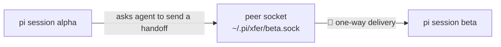

# Quickstart

Get your first handoff delivered between two pi agents in about five minutes.

## What is pi-xfer?

pi-xfer lets pi coding agents hand each other **structured markdown documents** — context, problem, requirements — instead of chat fragments. It works out of the box between agents on one machine (local Unix sockets), optionally across machines (the **Mesh**), and can pull structured context straight from your browser (the web picker). The rest of this guide covers the local path; see the architecture map at the end for how the pieces relate.

## Install

```bash
pi install npm:pi-xfer
```

Then start (or restart) pi so the extension loads.

## Your first handoff (30 seconds)

Open **two terminals in any project directory** and start two named pi sessions:

```bash
pi --xfer alpha   # terminal 1 — the sender
pi --xfer beta    # terminal 2 — the receiver
```

`--xfer` sets the session's **xfer name** — how other sessions address it. Without it, a name is derived automatically: the `name` in `.pi/settings.json` if set, otherwise `<dirname>_<random>` (see `deriveName` in the source). Naming explicitly keeps this guide unambiguous.



### Terminal 1 — `alpha` sends

The precise form is the slash command `/xfer <target> <request>` — the agent expands your request into a structured markdown document (Context / Problem / Requirements / Return address) and delivers it to the target:

```
/xfer beta Review the error handling in src/server.ts
```

Or, equivalently, just talk to the agent in plain language:

> Send a handoff to beta asking it to review the error handling in src/server.ts.

The handoff is delivered to `beta` over the local peer socket — one-way, no waiting for a reply.

To confirm `beta` is reachable first, run `/xfer list` — it shows every running session on this machine.

### Terminal 2 — `beta` receives

The handoff arrives as a message in `beta`'s conversation:

```
📨 [Xfer from **alpha**]

**Request**: Review the error handling in src/server.ts
**Doc**: /var/folders/.../pi-xfer-....md
```

Ask `beta` to read the doc and do the work — then reply the same way: *"Send alpha a handoff with your findings."*

That's the whole loop: one-way, structured markdown handoffs between peers.

## Where to go next

| Capability | Command | Guide |
|---|---|---|
| Async collaboration cards | `/xfer board list` | README → Board |
| Web picker (browser → handoff) | `/xfer broker start` + userscript | [`docs/dev/web-picker.md`](../dev/web-picker.md) |
| Cross-machine delivery | `/xfer mesh up` | Mesh setup guide (coming) |
| Local web console | `/xfer admin` | — |

## How the pieces fit together


The static image above is an export of the full interactive diagram — **[Open the interactive diagram](assets/xfer-architecture.html)** for pan/zoom, per-node source references, and a dark theme.

Three layers, bottom-up:

- **Peer transport (default)** — every pi session with the extension listens on a Unix socket at `~/.pi/xfer/<name>.sock`. Handoffs between sessions on one machine go directly over this socket. No daemon, no setup.
- **Broker (web picker)** — a small local daemon (`/xfer broker start`) that serves the Tampermonkey userscript. The browser sends **picks** and **records** to the broker, which turns them into a handoff delivered to a peer like any other.
- **Mesh (opt-in)** — join with `/xfer mesh up` and your instance becomes a **Node**: one actor in a shared network with engine-side discovery and a durable queue, so a handoff reaches a Node on another machine even if it's offline when sent. Local socket delivery is unaffected and stays the default.

Glossary for all terms: [`CONTEXT.md`](../../CONTEXT.md). Why the mesh is built the way it is: [`docs/adr/0013`](../adr/0013-xfer-mesh-rivetkit-transport.md).
