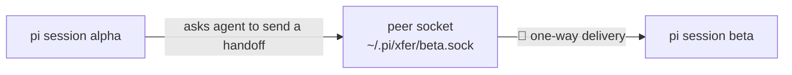

> 中文版 · 英文原文：[quickstart.md](quickstart.md)

# 快速开始

大约五分钟内，让你的第一份 handoff 在两个 pi agent 之间送达。

## pi-xfer 是什么？

pi-xfer 让 pi 编码 agent 互相递交**结构化的 markdown 文档**——上下文、问题、需求——而不是聊天碎片。它在同一台机器的 agent 之间开箱即用（本地 Unix socket），可选地跨机器工作（**Mesh**），还能直接从浏览器里抓取结构化上下文（web picker）。本指南余下部分讲本地路径；各部分如何配合见文末的架构图。

## 安装

```bash
pi install npm:pi-xfer
```

然后启动（或重启）pi，让扩展加载。

## 你的第一份 handoff（30 秒）

在**任意项目目录下开两个终端**，启动两个具名 pi 会话：

```bash
pi --xfer alpha   # terminal 1 — the sender
pi --xfer beta    # terminal 2 — the receiver
```

`--xfer` 设定会话的 **xfer 名称**——其他会话用它来寻址。不设时会自动推导出一个名字：`.pi/settings.json` 里的 `name`（若有），否则 `<dirname>_<random>`（见源码中的 `deriveName`）。显式命名能让本指南不含歧义。



### 终端 1 —— `alpha` 发送

精确形式是斜杠命令 `/xfer <target> <request>`——agent 会把你的请求展开成一份结构化的 markdown 文档（Context / Problem / Requirements / Return address）并投递给目标：

```
/xfer beta Review the error handling in src/server.ts
```

或者，等价地，直接用自然语言对 agent 说：

> 给 beta 发一份 handoff，让它审查 src/server.ts 里的错误处理。

handoff 通过本地 peer socket 投递给 `beta`——单向，不等待回信。

想先确认 `beta` 可达，运行 `/xfer list`——它列出本机所有正在运行的会话。

### 终端 2 —— `beta` 接收

handoff 以一条消息的形式出现在 `beta` 的对话里：

```
📨 [Xfer from **alpha**]

**Request**: Review the error handling in src/server.ts
**Doc**: /var/folders/.../pi-xfer-....md

**Sender cwd**: `/srv/app` (project app on machine laptop) — make all file edits here unless the doc says otherwise.
```

**Sender cwd** 这一行把 `beta` 锚定到 `alpha` 的工作目录，而不是 `beta` 碰巧所在的地方。每一份由 agent 生成的文档都以首行注释的形式携带同一个锚点（`<!-- xfer:sender-cwd cwd=… project=… machine=… branch=… -->`），因此它能扛过两种传输通道以及跨机投递——当该路径在接收方不存在时，`project`/`machine` 会把它指向正确的目录树。

让 `beta` 读这份文档并干活——然后用同样的方式回信：*“给 alpha 发一份 handoff，附上你的发现。”*

整个循环就是这些：peer 之间单向的、结构化的 markdown handoff。

## 接下来去哪儿

| 能力 | 命令 | 指南 |
|---|---|---|
| 安装自检（什么都没反应？） | `/xfer doctor` | — |
| 异步协作卡片 | `/xfer board list` | README → Board |
| Web picker（浏览器 → handoff） | `/xfer broker start` + 用户脚本 | [`docs/dev/web-picker.zh.md`](../dev/web-picker.zh.md) |
| 跨机投递 | `/xfer mesh up` | [`docs/guides/mesh-setup.zh.md`](mesh-setup.zh.md) |
| 本地 web 控制台 | `/xfer admin` | — |

## 各部分如何配合


上面这张静态图是完整交互式图的导出——**[打开交互式图](assets/xfer-architecture.html)** 可平移缩放、查看逐节点源码引用，以及深色主题。

三层，自下而上：

- **Peer 传输（默认）** — 每个加载了扩展的 pi 会话都在 `~/.pi/xfer/<name>.sock` 上监听一个 Unix socket。同一台机器上会话之间的 handoff 直接走这个 socket。无守护进程，无需配置。
- **Broker（web picker）** — 一个小的本地守护进程（`/xfer broker start`），为 Tampermonkey 用户脚本提供服务。浏览器把 **picks** 和 **records** 发给 broker，broker 把它们变成一份 handoff，像其他 handoff 一样投递给某个 peer。
- **Mesh（可选）** — 用 `/xfer mesh up` 加入后，你的实例就成为一个 **Node**：共享网络中的一个 actor，具备引擎侧发现和持久队列，因此即使目标 Node 在发送时离线，handoff 也能送达另一台机器上的它。本地 socket 投递不受影响，仍是默认路径。

所有术语的词汇表：[`CONTEXT.zh.md`](../../CONTEXT.zh.md)。Mesh 为何这样构建：[`docs/adr/0013`](../adr/0013-xfer-mesh-rivetkit-transport.zh.md)。
